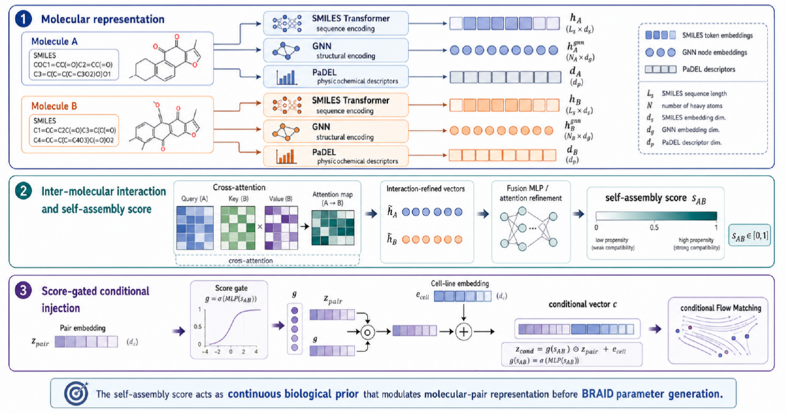
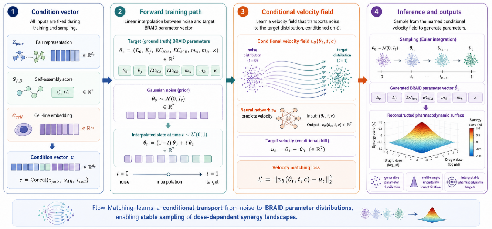
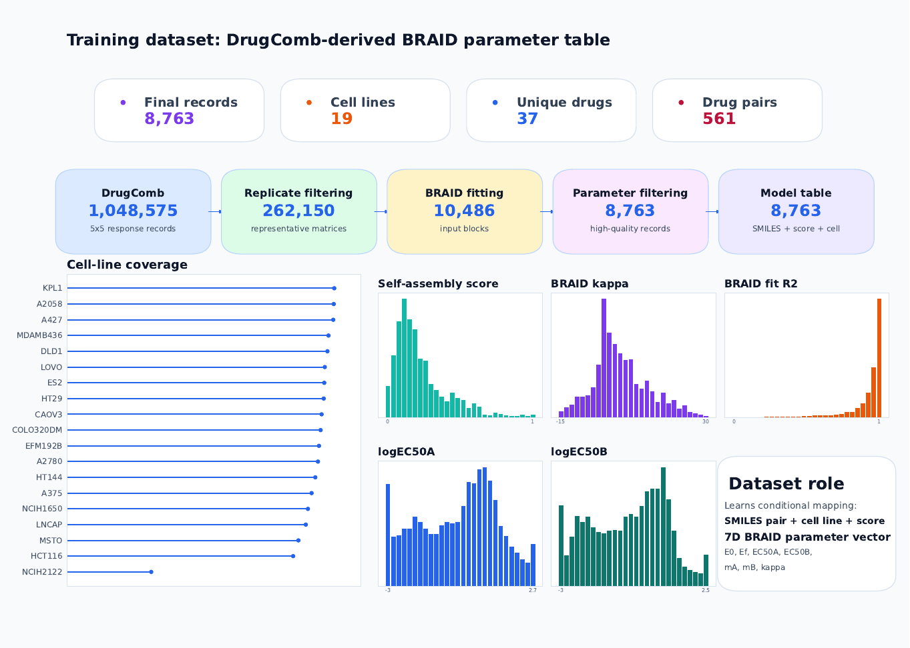
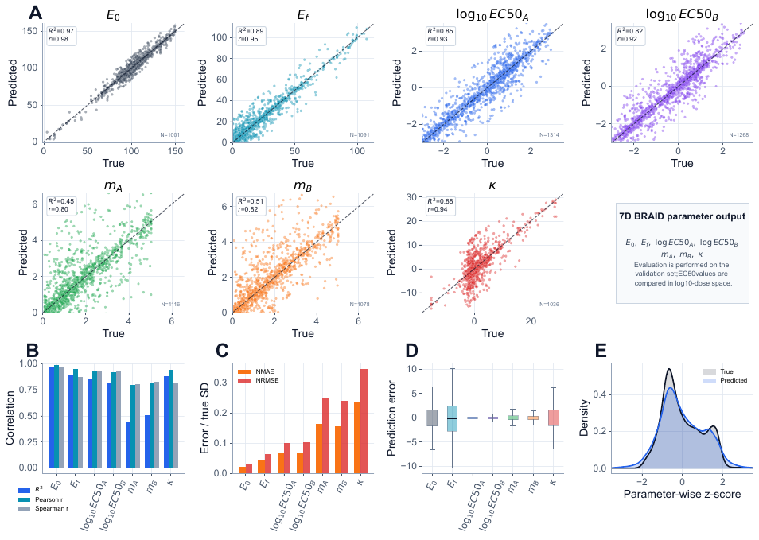
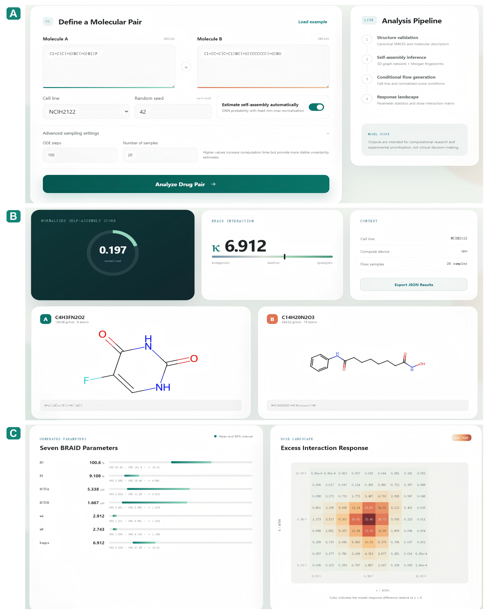

<div align="center">

# BRAID-FlowMatcher

### Self-Assembly-Guided Conditional Flow Matching for Drug-Pair BRAID Parameter Generation

[](https://www.python.org/)
[](https://pytorch.org/)
[](https://www.rdkit.org/)


**Companion code and data for an interpretable generative framework that maps a molecular pair, cell-line context, and normalized self-assembly condition to a seven-dimensional BRAID pharmacodynamic parameter distribution.**

</div>

---

## Overview

Most drug-combination models predict a single synergy score. BRAID-FlowMatcher instead generates a complete, interpretable pharmacodynamic parameter vector:

$$
\boldsymbol{\theta}=
(E_0,E_f,\log_{10}EC_{50,A},\log_{10}EC_{50,B},m_A,m_B,\kappa).
$$

The framework combines:

- molecular sequence and structural representations;
- cross-molecular interaction modeling;
- a continuous, normalized self-assembly score;
- cell-line context;
- conditional Flow Matching for repeated parameter generation and uncertainty analysis.

The generated vector can be used to reconstruct a dose-dependent interaction surface rather than reducing the prediction to one scalar endpoint.



> **Scope.** The self-assembly score is used as a conditional molecular-pair prior. It is not interpreted as direct evidence of biological causality. The generated surfaces are model predictions and require experimental validation.

---

## At a Glance

| Component | Description |
|---|---|
| Primary input | Two molecular SMILES strings, a cell line, and a normalized self-assembly score |
| Primary output | Seven BRAID pharmacodynamic parameters |
| Generative model | Conditional Flow Matching |
| Molecular interaction model | Transformer representations with cross-molecular interaction refinement |
| Final Flow dataset | 8,763 drug-pair--cell-line records |
| Coverage | 37 unique drugs, 561 drug pairs, and 19 cell lines |
| Self-assembly dataset | 1,875 labeled molecular-pair records |
| Downstream use | Dose-response reconstruction, repeated-sampling uncertainty, and exploratory herb-pair aggregation |

---

## Method

### 1. Molecular-pair representation and self-assembly conditioning

Each molecule is represented using complementary sequence, graph, and physicochemical information. Cross-molecular interaction layers refine the pair representation. A learned gate controls how strongly the continuous self-assembly condition modulates the molecular-pair representation before BRAID parameter generation.

### 2. Conditional Flow Matching

The Flow Matching model learns a time-dependent conditional velocity field that transports a Gaussian prior toward the observed BRAID parameter distribution. During inference, repeated samples produce a parameter distribution and corresponding uncertainty summaries.



### 3. Self-assembly score normalization

The raw self-assembly sigmoid probability, $p$, is not passed directly to the Flow Matching model. The final conditional dataset and inference workflow use the same fixed min--max transformation:

$$
s=\mathrm{clip}\left(
\frac{p-p_{\min}}{p_{\max}-p_{\min}},0,1
\right).
$$

Here, $p_{\min}$ and $p_{\max}$ are fixed normalization bounds estimated from the training distribution. The normalized value $s$ is the model condition. The raw probability is retained only as an auditable intermediate quantity.

---

## BRAID Outputs

| Parameter | Interpretation |
|---|---|
| $E_0$ | Baseline response |
| $E_f$ | Asymptotic response |
| $\log_{10}EC_{50,A}$ | Log-scale half-maximal concentration for molecule A |
| $\log_{10}EC_{50,B}$ | Log-scale half-maximal concentration for molecule B |
| $m_A$ | Dose-response slope for molecule A |
| $m_B$ | Dose-response slope for molecule B |
| $\kappa$ | BRAID interaction parameter |

Positive or negative values of $\kappa$ indicate the direction of the inferred interaction relative to the BRAID reference. Interpretation should always consider the generated uncertainty and the fitted parameter domain.

---

## Data Included in This Repository

### Flow Matching dataset

`flow_model_train_data.csv` contains 8,763 quality-filtered records derived from reconstructed DrugComb dose matrices.

| Field group | Columns |
|---|---|
| Record identifiers | `BlockID`, `Cell Line`, `DrugA`, `DrugB` |
| Molecular inputs | `SMILES_A`, `SMILES_B` |
| Self-assembly condition | `score` |
| BRAID targets | `E0`, `Ef`, `EC50A`, `EC50B`, `logEC50A`, `logEC50B`, `mA`, `mB`, `kappa` |
| Fit diagnostics | `R2`, `fit_success`, `error` |



### Self-assembly dataset

`self_assembly_data.tsv` contains 1,875 labeled molecular pairs with the following columns:

```text
DRUG_SMILES    EXCIPIENT_SMILES    CLASS
```

`CLASS` is the binary target used to train the self-assembly predictor. The downstream Flow Matching model uses the predictor's normalized continuous score, not a hard class label.

---

## Repository Layout

```text
BRAID-FlowMatcher-main/
├── README.md
├── flow_model_train_data.csv   # Final conditional Flow Matching table
├── flow_model_trans.py         # Flow Matching training and evaluation
├── flow_model_use.py           # Repeated-sampling inference example
├── self_assembly_data.tsv      # Raw self-assembly training table
├── tsv_pt_data.py              # TSV-to-PyTorch preprocessing
├── self_assembly_models.py     # Self-assembly network definition
├── self_assembly_train.py      # Self-assembly training entry point
├── herb_prediction.py          # Exploratory molecule-to-herb aggregation
└── docs/
    └── assets/                 # README figures
```

Generated training artifacts are not source files and are therefore shown separately:

```text
flow_result/
├── flow_best2.pt
├── vocab.json
├── cell2id.json
├── theta_mean.npy
└── theta_std.npy

checkpoints/
└── best_model_epoch*_auc*.pt
```

---

## Environment

Recommended environment:

- Python 3.10 or 3.11
- PyTorch 2.x
- NumPy
- pandas
- scikit-learn
- RDKit
- tqdm

Example installation:

```bash
python -m venv .venv
```

Windows PowerShell:

```powershell
.\.venv\Scripts\Activate.ps1
python -m pip install --upgrade pip
python -m pip install torch numpy pandas scikit-learn rdkit tqdm
```

Linux or macOS:

```bash
source .venv/bin/activate
python -m pip install --upgrade pip
python -m pip install torch numpy pandas scikit-learn rdkit tqdm
```

For GPU execution, install the PyTorch build compatible with the local CUDA runtime.

---

## Reproduction Workflow

### Step 1: preprocess the self-assembly dataset

```bash
python tsv_pt_data.py \
  --tsv self_assembly_data.tsv \
  --out self_assembly_data.pt \
  --max 0
```

Expected output:

```text
self_assembly_data.pt
```

### Step 2: train the self-assembly predictor

```bash
python self_assembly_train.py \
  --processed self_assembly_data.pt \
  --epochs 65 \
  --batch_size 8 \
  --seed 42 \
  --save_dir checkpoints
```

The compact code snapshot imports `AssemblyDataset`, `collate_fn`, and training utilities from `dataset.py`, `models.py`, and `utils.py`. These helper modules must be present in the repository root before this training command is run. See [Release Completeness](#release-completeness).

### Step 3: train the conditional Flow Matching model

Before training, ensure that the dataset configuration in `flow_model_trans.py` points to the included table:

```python
CSV_PATH = "flow_model_train_data.csv"
SAVE_DIR = "flow_result"
```

Then run:

```bash
python flow_model_trans.py
```

The training script writes the vocabulary, cell-line mapping, target-scaling statistics, training history, evaluation tables, and the best checkpoint into `flow_result/`.

### Step 4: run repeated-sampling inference

`flow_model_use.py` demonstrates inference for a single molecular pair. Confirm that its model-loading block points to the generated checkpoint:

```python
stats_path = "flow_result"
weight_name = "flow_best2.pt"
```

Then run:

```bash
python flow_model_use.py
```

The example writes individual generated samples to:

```text
single_prediction_samples.csv
```

### Step 5: optional herb-level application

`herb_prediction.py` performs exploratory cross-herb molecular-pair scoring and aggregation. This is a downstream application rather than a supervised target of the BRAID generator.

```bash
python herb_prediction.py \
  --input <compound_to_herb_table.csv> \
  --ckpt <self_assembly_checkpoint.pt> \
  --out herb_molecule_pairs_predictions.csv \
  --device cuda
```

Use `--device cpu` when CUDA is unavailable.

---

## Evaluation Snapshot

The model is evaluated parameter by parameter rather than only through a derived synergy label. The manuscript reports comparisons in the physical, logarithmic, and standardized target spaces, together with residual diagnostics and repeated-sampling analyses.



The figure is a descriptive snapshot of the manuscript evaluation. Exact values should be read from the corresponding result tables produced by the training script rather than inferred from the rendered image.

---

## BRAID Studio Research Interface

The trained self-assembly and Flow Matching models were also integrated into a local single-page research prototype. The interface accepts two SMILES strings and a cell-line condition, applies the same self-assembly normalization used by the final conditional dataset, performs repeated generation, and visualizes the reconstructed interaction landscape.



The interface is a research prototype. It is not a clinical decision-support system, and its outputs do not replace experimental validation.

---

## Release Completeness

This repository contains the principal publication scripts and the two tabular datasets. A fully executable archival release should additionally contain or link to:

- `dataset.py`, `models.py`, and `utils.py`, which are imported by `self_assembly_train.py`;
- the trained self-assembly checkpoint, if pretrained inference is intended;
- the `flow_result/` checkpoint and metadata files, if inference without retraining is intended;
- the compound-to-herb mapping table required by `herb_prediction.py`;
- a pinned dependency file and software-version record.

These items are intentionally stated here so that reviewers can distinguish source code, generated artifacts, and external application data. Do not treat a missing generated checkpoint as part of the training dataset.

---

## Reproducibility Notes

- Use a fixed random seed when comparing repeated-sampling configurations.
- Keep the same SMILES tokenizer, vocabulary, cell-line mapping, and target normalization statistics between training and inference.
- Use the normalized self-assembly score as the Flow condition; do not substitute the raw sigmoid probability.
- Preserve the order of the seven target parameters.
- Report the number of ODE integration steps and generated samples with each inference experiment.
- Predictions for molecules or biological contexts outside the development distribution require additional caution.

---

## Citation

If this repository supports your work, please cite the associated manuscript:

> *Self-Assembly-Guided Conditional Flow Matching for Drug-Pair BRAID Pharmacodynamic Parameter Generation.*

Complete journal, author, DOI, and BibTeX information should be added here when the manuscript record becomes publicly available.

---

## License and Intended Use

No software license is included in this repository snapshot. Contact the authors before redistribution or reuse beyond manuscript review. The code and generated outputs are provided for research purposes only.

